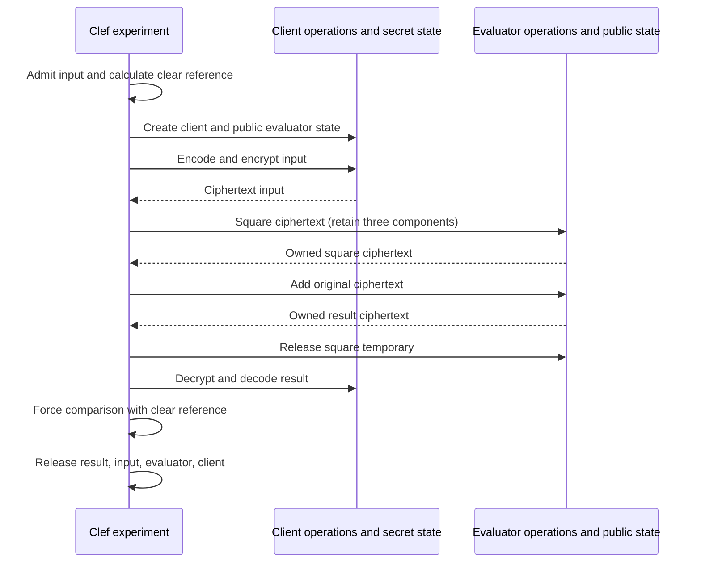

# The synchronous demonstrator

[Documentation index](README.md)

The first encrypted run uses the Clef cryptographic implementation through synchronous function calls. Use one executable, one client state, one evaluator state and one input per run. Start with `6`, then repeat with `0` and `100`. The initial encoder places the scalar in the constant coefficient of a plaintext polynomial. SIMD packing is a later encoding with its own relation and tests. Actor hosting, scheduling, persistence, transport and compiler optimization follow this first run.



The evaluator function receives evaluator state and ciphertext through an interface without decryption. The executable still holds the client's secret key. Isolating an untrusted evaluator requires a separate process.

## Clef source

[Experiment.clef](../src/Experiment.clef) contains the synchronous orchestration. [Protocol.clef](../src/Protocol.clef) defines the local `ClientCalls` and `EvaluatorCalls` records for first-party Clef operations in Fidelity.Cryptography. Their state and value types are abstract.

[Arithmetic.clef](../src/Arithmetic.clef) defines one operation sequence, `polynomial`: square the input, add the original, release the square temporary, return the answer. The clear reference supplies ordinary integer square/add and a no-op value release. The encrypted evaluator supplies completed ciphertext square/add and the real ciphertext release. Both use the same application expression. The library implements the cryptographic operations explicitly.

The encrypted evaluator's source is:

```fsharp
let evaluate calls state input =
    HelloFHE.Arithmetic.polynomial
        (fun value -> calls.Square state value)
        (fun left right -> calls.Add state left right)
        calls.ReleaseCiphertext
        input
```

`Experiment.run` admits the clear input before creating keys. It creates client state, derives a public evaluator state, encrypts, calls `evaluate`, decrypts and compares against `Arithmetic.calculate`. Nested matches choose every success or error path. Release occurs in reverse dependency order. The public exit code identifies the failed stage without retaining the provider's error value or logging secret-bearing diagnostics.

| Exit | Meaning | Resources retired before return |
| --- | --- | --- |
| `0` | Decrypted answer equals the clear reference | Square temporary, answer, input, evaluator and client |
| `2` | Clear input outside `0..100` | Nothing created; no key generation or encryption |
| `3` | Client creation failed | Provider cleans any partial client allocation |
| `4` | Public evaluator creation failed | Provider cleans partial evaluator allocation; client released |
| `5` | Encryption failed | Provider cleans partial ciphertext; evaluator and client released |
| `6` | Square or add failed | Square released if created; input, evaluator and client released |
| `7` | Decryption failed | Answer, input, evaluator and client released |
| `8` | Decryption completed but result mismatched | Same completed cleanup as success |

The current `Program.clef` continues to call the clear reference. Connecting the real experiment means constructing the two call records from the admitted provider and calling `Experiment.run clientCalls evaluatorCalls 6`. Use that invocation when changing the entry point. A missing provider must produce an unavailable result; do not install a successful cleartext substitute. The first implementation uses functions, callbacks, records, arrays, loops and matches, with cryptography written in Clef.

## Provider operations to implement

Implement these operations in Fidelity.Cryptography. The application records specify the calls needed by the experiment. Wire format, target support and provider admission require their own contracts.

| Local call | Required provider implementation | Completed result |
| --- | --- | --- |
| `ClientCalls.Create` | Validate the fixed BFV parameter profile; obtain randomness through the admitted entropy service; create Clef parameter records, coefficient arrays, sampler state and secret/public encryption material | An owned client bundle, or failure with no escaped allocation |
| `CreateEvaluator` | Create independently owned Clef public parameter/evaluation state; do not capture client secret or sampler state | Public evaluator state, with no secret key, decrypt operation or secret-bearing sampler |
| `Encrypt` | Admit the scalar, encode it as a constant plaintext polynomial, run first-party public-key encryption in Clef, retire plaintext staging | One independently owned ciphertext bound to the context/key set |
| `EvaluatorCalls.Square` | Compute the BFV square with its required widened products and scale/round operation into a fresh three-component ciphertext | A fresh completed ciphertext; original retained for the add |
| `Add` | Check compatible context/representation, add the square and preserved input into a fresh destination | An answer independent of both input allocations |
| `Decrypt` | Client-only Clef decryption for the declared component count, then constant-coefficient decoding; materialize the integer and retire plaintext working arrays | A materialized Clef integer in the selected representation |
| `ReleaseCiphertext` | Retire the owned Clef coefficient storage under its DMM/region contract | No borrowed reference or deferred native work survives |
| `ReleaseEvaluator`, `ReleaseClient` | Release bundle members in dependency order and satisfy the applicable sensitive-state cleanup contract | Completion with no remaining owned resource |

A successful `Result` must contain a completed value whose prerequisites can be retired safely. Failed operations clean up partial allocations. Release functions are total and do not throw. Use explicit Clef result paths, with partial region ownership accounted for on failure. Calls complete synchronously before returning.

Because Clef bindings are shared deferred computations, the code matches provider outcomes before releasing their prerequisites, and branches on `actual = expected` before releasing the answer or client. It returns a literal status after cleanup, never a deferred decoded value or a borrowed coefficient view. Check decode, comparison and retirement ordering in the lowered native operations.

At the add boundary the live ciphertext set is bounded: original input, square temporary and fresh answer, plus provider scratch. The square retires immediately after add completion; the answer and input retire after the client comparison. Erasure of keys, plaintext, spills and temporary copies requires additional provider and lowering evidence.

## First native acceptance

| Check | Required observation |
| --- | --- |
| Source-only reference | Native runs cover `0`, `6`, `100`; `-1`, `101` reject before provider calls |
| Real encryption | Separate runs decrypt to `0`, `42`, `10100`; encryption and evaluation execute the first-party Clef implementation |
| Evaluator scope | Evaluator state and closures contain context/evaluation material only; `evaluate` receives no clear input or expected answer |
| Lifecycle faults | Fail each creation/operation boundary; count each successful allocation's matching release, including square success followed by add failure |
| Result control | A wrong decrypted value returns `8`; decryption failure returns `7`; neither reports success |
| Lowered sequencing | Native evidence shows comparison/decode completed before their prerequisites are released; no secret view escapes |
| Clef proof path | Inspect the PSG participants, generated obligations, MLIR/SMT correspondence and checked lowering evidence for the actual Clef kernels |

The expected output for input `6` is `HelloFHE: encrypted evaluation returned 42`. Print it only after status `0`.

The implementation work is detailed in [02: First-party Clef cryptography](02-first-party-cryptography.md). Its proof-instrumentation acceptance is defined in [03: Tier 1-4 proof instrumentation](03-proof-instrumentation.md).
