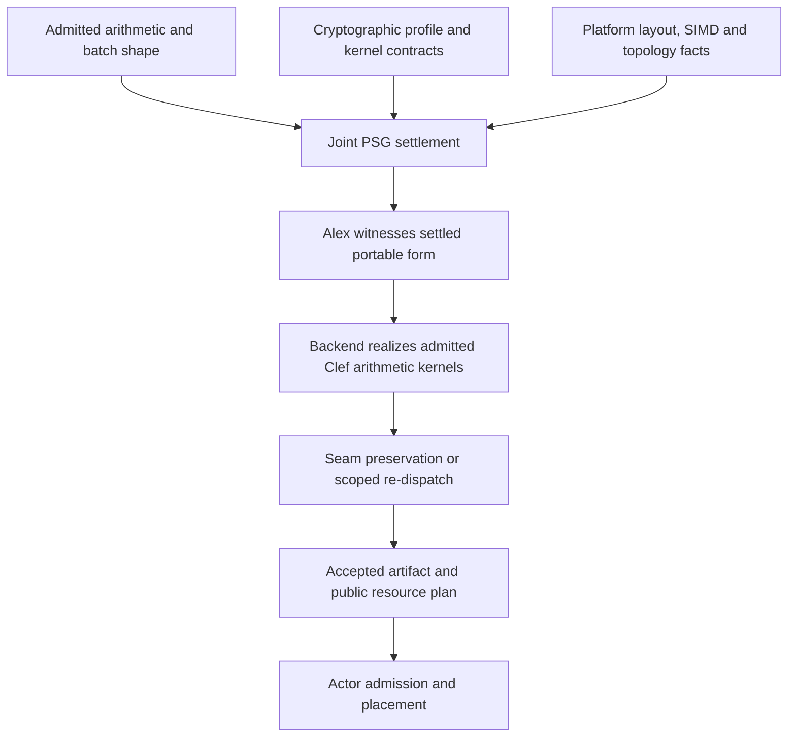

# Cache-aware compilation

[Documentation index](README.md)

## Joint settlement and compiler ownership

Carry the following participants together in the PSG: source revision and admitted arithmetic branch; lane/slot map and padding; parameter and key requirements; coefficient/NTT form and level at each edge; buffer extents, alignment, aliases and last use; target instruction features, memory spaces and topology; kernel dependencies and completion events. A local change to one participant invalidates the dependent schedule and evidence.

Extend the owning CCS/Baker representation and scheduling work, the existing Alex admission mechanism and the selected backend leg. Do not add a semantic FHE dialect, an MLIR plugin or a middle-end pass that rediscovers packing and ownership. An uncertified optimization must re-dispatch affected obligations at the matching seam scope. An unsupported obligation remains unresolved and blocks the dependent commitment.

Keep scalar and optimized Clef realizations of the same circuit plan. The scalar version supplies the arithmetic and proof baseline. The optimized version uses admitted modular arithmetic, NTT and scheduling laws so Baker can settle layout and schedule and the backend can realize target SIMD. Both remain visible Clef implementations under the same verification machinery. A relational result connects their semantics; native acceptance establishes the actual target artifact.

## Coefficient layout and working-set model

Recommend a compute view indexed by `[ciphertext component][RNS limb][coefficient]`, with coefficients contiguous in each limb and fixed-width unsigned storage admitted by the kernel. This layout is a candidate for Clef computation. Keep transport serialization and owned computation buffers distinct. Conversion between them has a checked map and measured cost; never reinterpret a serialized ciphertext as an arbitrary coefficient array.

Let `N` be ring degree, `L` the active limb count, `c` the component count and `w` bytes per stored coefficient. The uncompressed coefficient payload is `c * L * N * w`. Headers, alignment, allocator metadata, auxiliary key-switch bases, twiddle tables and scratch are additional. Account for the larger basis and component count during multiplication/key switching as well as the final ciphertext.

For illustration only, `N=8192`, `L=3`, `w=8` gives 384 KiB for a two-component ciphertext and 576 KiB for three components. A later relinearized realization preserving an input alongside a three-component product and a two-component result totals 1344 KiB before evaluation keys and scratch. The initial unrelinearized realization instead reserves its actual three-component answer. These figures describe storage only. Modulus-chain selection and cache residency require separate evidence.

For each candidate schedule, calculate peak live buffers plus the active key/table portion and transport staging. Use full allocation extents and touched cache lines, following the CPU design; useful coefficient bytes alone undercount traffic. Compare that model with target cache capacities, associativity assumptions and competing traffic. Measure cache behavior under the expected competing traffic.

## Recommended kernel patterns

| Kernel or boundary | Recommended pattern | Conditions to preserve |
| --- | --- | --- |
| Coefficient add/multiply | Vectorize contiguous coefficients within one limb; public fixed trip counts; handle tails with admitted masks or a scalar tail | Modular congruence, intermediate width and lazy-reduction bounds, alignment and alias rules |
| NTT/inverse NTT | Stage-aware blocking; retain contiguous butterfly groups and public twiddles; use an explicit permutation or staging buffer for cross-tile stages | Exact root/order convention, coefficient versus transform form, dependency order and scratch bounds; a tile cannot be transformed independently when butterflies cross it |
| Square and relinearize | Reuse the input transform where the backend contract permits; retain the original value for the final add; stream key-switch material in bounded chunks | Component count, extended RNS basis, decomposition, level/form compatibility and last-use boundaries |
| Producer/consumer fusion | Fuse coefficient operations or compatible transform stages only after the joint relation establishes legality | No changed modular overflow behavior, key-switch semantics, ordering or side-channel contract |
| Wire to compute | One bounded decode into an owned compute arena; reuse accepted native storage when layout and ownership already agree | Measured layout/codec, limits before allocation, no hidden copy or stale alias |
| Repeated jobs | Retain read-only context, twiddles and evaluation material; use one exclusive scratch arena per active worker | Bounded public cache, key-set separation, backend thread safety, completion before reuse |

As a starting tile candidate, 256 coefficients across three 64-bit arrays occupy 6 KiB before twiddles and other live state. Enumerate a small target-specific set of legal tile sizes and vector widths at design/build time; include cross-tile traffic, register spills and conversion in the cost. Select from public profile data and retained measurements. Do not hardcode this candidate into source semantics.

Intel's [HEXL paper](https://arxiv.org/abs/2103.16400) identifies NTT and modular multiplication as important vectorization targets. The [HEXL implementation](https://github.com/IntelLabs/hexl) supplies native and AVX-512 paths with CPU-feature dispatch and modulus-dependent arithmetic constraints. Use that published work to inform the first-party Clef kernels; do not infer that an ordinary integer vector multiply implements full modular multiplication safely. For a generated path, discharge the bounds required by each multiply/reduction recipe, including IFMA accumulation where selected.

Obtain vector features and OS support from the selected platform/CPU contract. Generate or select an admitted scalar fallback when the deployment policy permits it; an explicitly required feature fails admission when absent. Measure AVX2/AVX-512 candidates where supported, accounting for frequency and bandwidth effects. Wider vectors do not establish a speedup.

## Placement, concurrency and GPU realization

Start with one worker and a fixed backend thread budget. Increase workers only within a measured byte budget. Choose either multiple mostly single-threaded evaluators or a smaller number of internally parallel evaluators; bound their product against the CPU allocation to avoid nested oversubscription.

Prospero's placement policy should prefer a stable cache/NUMA domain for a session's public material when that reduces total cost. Account for queue delay and load balance before pinning. Use first-touch or supported placement to locate the arena's physical pages under that policy. Align and round mutable worker metadata, queue endpoints and counters using the actual sharing granularity. Never change the declared transport layout silently.

For GPU execution, retain coefficient-contiguous access across neighboring lanes, stage only butterflies whose reuse repays LDS/shared-memory and barrier cost, and make cross-workgroup dependencies separate launches or another admitted synchronization mechanism. Batch enough independent ciphertext work to amortize launch and transfers. Keep host and device buffers live until the recorded completion event, then publish the reply. Check these obligations through the GPU host-dispatch and completion contracts. Use CPU execution for the initial latency baseline, then compare device end-to-end cost for larger batches.

## Side-channel and optimization contract

The worker follows a schedule determined by public circuit, context, shape and deployment profile. Do not skip encrypted zero lanes, choose secret-dependent addresses, or tune from decrypted results. Batch length, queue timing and context identity are public metadata in the first profile; hiding them requires fixed-size padding and a separately stated traffic/scheduling contract.

A fixed circuit does not establish side-channel resilience of key generation, encryption, decryption, modular reduction or memory handling. Inspect backend contracts and lowered code for the selected observer model. Secret-side clearing must survive optimization and cover copies and library allocations. Dispatch among public CPU capabilities is compatible with this design; secret-dependent dispatch is not. Hold cryptographic parameters fixed during cache experiments.

Tier 2 supplies local range, width, alignment and resource premises. Tier 3 can supply registered kernel and service lemmas. Tier 4 relates realizations, traces or distributions, including computational RHL/pRHL confidentiality and leakage judgments under named assumptions. Security is one use of its broader relational remit. Profile counters support measured performance claims; they do not discharge a leakage theorem.

The local [OpenFHE HEXL study](08-openfhe-study-and-attribution.md#hexl-modular-arithmetic-and-transforms) pins the arithmetic and transform excerpts that inform this plan. Its lessons become contracts and original Clef kernels under the existing proof owners.
